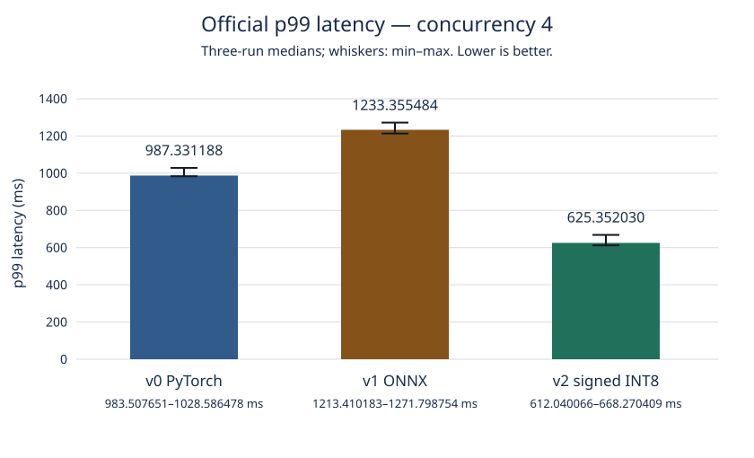

# Measured Model Serving

A reproducible CPU-only sentiment-classification service comparing PyTorch, ONNX Runtime, and signed 8-bit dynamic quantization.

**At concurrency 4, signed INT8 reduced median p99 latency from 987.33 ms to 625.35 ms (36.66% improvement), with 100% matching labels on the fixed 1,000-sentence dataset.** Unquantized ONNX was 24.92% slower at p99 and was rejected.

Official concurrency-4 results, each the median of three valid run-level statistics:

| Version | p50 (ms) | p95 (ms) | p99 (ms) | Requests/s | Peak container memory (bytes) | Docker image size (bytes) | Label agreement with original v0 | Decision |
| --- | --- | --- | --- | --- | --- | --- | --- | --- |
| v0 PyTorch | 367.973152 | 859.620583 | 987.331188 | 9.467402 | 527626240 | 2106058478 | Reference | **BASELINE** |
| v1 ONNX | 402.820539 | 985.267498 | 1233.355484 | 8.510558 | 549056512 | 983250492 | 100% | **REJECT** |
| v2 signed INT8 | 278.551001 | 522.090772 | 625.352030 | 13.519013 | 323043328 | 720020107 | 100% | **KEEP** |

Decisions apply to this registered experiment on this VM. Memory is the container's **cgroup memory.peak**, including startup and warm-ups; image size is Docker's built-image size. Both columns use exact bytes (MiB, where used in the detailed report, means bytes / 1,048,576). Agreement is **6,000/6,000 HTTP labels per candidate across six runs**, with no mismatches in any length bucket; it is not human-labeled accuracy.

```text
Client HTTP request → FastAPI validation → Tokenizer → Model runtime
  Build-time runtime: v0 PyTorch / Transformers
                      v1 ONNX Runtime CPU
                      v2 ONNX Runtime CPU + signed INT8 MatMul quantization
Model runtime → Label, score and stage timings → HTTP response
```

[Inspect the full results](docs/benchmark_report.md) · [Reproduce the saved-data report](#reproduce-the-saved-data-report) · [Service API](#service-api) · [Historical evidence](#historical-evidence)



Concurrency-4 p99, median of three valid repetitions, calculated from saved original observations. Whiskers show minimum–maximum; lower is better. The [detailed report](docs/benchmark_report.md) includes both concurrency settings, all medians and ranges, startup times, server stages, variation disclosures, and original JSON references.

## Architecture and engineering choices

The service classifies English sentiment with the pinned `distilbert/distilbert-base-uncased-finetuned-sst-2-english` model at revision `714eb0fa89d2f80546fda750413ed43d93601a13`. All versions share one HTTP contract, one non-root Uvicorn worker, four model threads, four CPUs and a 2-GiB container limit. Runtime selection happens when building the image. Requests are handled individually; there is no dynamic batching or GPU inference.

- **v0:** the original pinned classifier with CPU PyTorch 2.14.1+cpu and Transformers 5.19.0. [Dockerfile](Dockerfile), [service](src/app.py), [official baseline](results/v0-baseline/).
- **v1:** legacy `torch.onnx.export` with `dynamo=False`, opset 17, and dynamic batch/sequence axes. ONNX Runtime 1.31.0 uses the CPU execution provider and a standalone tokenizers 0.23.3 artifact. PyTorch and Transformers are absent from the runtime image. Export and tokenizer parity passed; preserved predictions did not translate into passing concurrency-4 performance. [Exporter](scripts/export_onnx.py), [tokenizer verification](scripts/verify_tokenizer.py), [export evidence](results/parity/v1-export.json), [tokenizer evidence](results/parity/v1-tokenizer.json), [container evidence](results/checks/v1-container.json), [Dockerfile.v1](Dockerfile.v1).
- **v2:** the verified v1 model transformed by ONNX Runtime's `quantize_dynamic`, with `weight_type=QuantType.QInt8` and `op_types_to_quantize=["MatMul"]`. The graph has **38 signed INT8 matrix weights and 38 quantized MatMul operations**. Two embedding tables retain their original FLOAT32 values; there are no unsigned quantized model weights. Dynamic activations can use UINT8, so this is not an entirely 8-bit model. [Quantizer](scripts/quantize_onnx.py), [corrected quantization evidence](results/parity/v2-quantization.json), [container evidence](results/checks/v2-container.json), [Dockerfile.v2](Dockerfile.v2).

The first default quantization attempt produced 38 INT8 matrix weights and two UINT8 embedding weights. It failed the signed-weight requirement before inference; label quality was not evaluated. Its [rejected implementation evidence](results/parity/v2-quantization-default-failure.json) and ignored cached model were preserved. The official v2 experiment uses only the corrected MatMul-only model.

## Registered experiment design

The [committed thresholds](bench/thresholds.yaml) were registered before any performance run, including the thread diagnostic, so optimized measurements could not determine their own acceptance rules. The [runner](bench/run_load.py) was frozen before official v0 measurement and reused unchanged across versions.

- **p99:** tail latency captures slow requests that a typical-request median can hide. Each run uses all 1,000 fixed IDs, giving a reproducible nearest-rank p99 at sorted observation 990; p50 and p95 use observations 500 and 950. No interpolated percentiles are used.
- **Warm-up and coverage:** 100 separate successful warm-ups precede each measured run and are excluded from latency statistics, throughput and label comparison. Every measured ID must succeed exactly once, in the same seeded order. This separates warm-up effects and holds workload composition fixed.
- **Concurrency and repetitions:** concurrency 1 exposes serial behavior; concurrency 4 is the primary workload within the four-CPU limit. Three valid repetitions per setting support a median and minimum–maximum range rather than a single timing.
- **Threads:** the v0-only 4/2/1-thread diagnostic selected four threads. That count was frozen for every runtime to avoid separately tuning ONNX to favor a result. The original scores and selection arithmetic remain in the historical evidence below.

Let `B` be the median of the three original concurrency-4 v0 p99 values, `C` the candidate median, `I=(B-C)/B`, and `S=(max(v0 p99)-min(v0 p99))/B`. The rules require:

1. `I >= 0.20` **and** `I > S` for performance PASS.
2. At least 990 of the fixed 1,000 IDs matching v0 labels: **99% label agreement**.
3. All mandatory validity, correctness and parity checks for KEEP. Any failed request, including a warm-up failure, or missing/inconsistent mandatory evidence invalidates an attempt.

If `I >= 0.20` but `I <= S`, performance is INCONCLUSIVE. Performance FAIL or quality below 99% takes REJECT precedence; passing quality with inconclusive performance remains INCONCLUSIVE. Unresolved mandatory failures prevent KEEP. Invalid attempts are preserved and excluded, with at most two retries of the same run slot; exhaustion stops benchmarking. Same-version variation strictly above 10% must be disclosed, without replacing valid noisy runs. Concurrency 1 is reported fully and does not decide acceptance.

The original baseline spread is **4.565725% (about 4.57%)**. V1's **−24.918112% improvement** means its p99 is about 24.92% worse, so **REJECT**. V2's **36.662385% improvement** exceeds both the 20% minimum and the baseline spread; quality and mandatory checks pass, so **KEEP for this experiment**. Neither candidate is inconclusive. The [report's variation disclosures](docs/benchmark_report.md#variation-disclosures) and the historical warnings retain all observed variation above 10%.

## Reproduce the saved-data report

Reading [the Markdown report](docs/benchmark_report.md), [SVG](docs/p99_by_version.svg), and committed JSON requires no model, Docker or network. Regenerating the report reads saved data; it does not rerun the performance experiment.

The measured environment was an ARM64 Ubuntu 26.04.1 VM with Python **3.14.4**. A clean clone needs a project-local `.venv` prepared before these commands. For saved-data analysis and offline tests, use the pytest pins in [requirements-ci.lock](requirements-ci.lock) plus the eight httpx/PyYAML dependency pins selected from [requirements-dev.lock](requirements-dev.lock) by [CI](.github/workflows/ci.yml); model libraries are unnecessary. Installing those packages needs package-index access unless their wheels are cached. Offline test execution is separate from that bootstrap.

For model preparation and full local tests, use the pinned development inventory, installing CPU-only PyTorch first from `https://download.pytorch.org/whl/cpu` with binary wheels; do not install NVIDIA, CUDA or Triton packages. No API key, Hugging Face token or GPU is required. `scripts/env.sh` activates the existing `.venv` and directs `TMPDIR` to the project's `tmp/` and `PIP_CACHE_DIR` to `.pip-cache/` on the main disk. It does not create the virtual environment or install packages. Source it before Python tools; do not use `/tmp` for heavyweight work.

From the project root, inspect Git state and verify the saved report without writing:

```bash
git status --short --branch --untracked-files=all
git rev-parse HEAD
source scripts/env.sh
PYTHONDONTWRITEBYTECODE=1 python bench/report.py --check
```

To refresh only the two generated report outputs, use the implemented `make report` target, equivalent to `source scripts/env.sh && PYTHONDONTWRITEBYTECODE=1 python bench/report.py`. It requires the existing Python environment, including httpx and PyYAML imported by the frozen helper module; no model packages are loaded and no new dependency is downloaded.

`make test` is the offline suite: synthetic-data generation with a fake tokenizer, saved-report validation, benchmark validity, and mocked reproduction safety. It needs neither ignored artifacts nor Docker. Its expanded command is:

```bash
source scripts/env.sh
PYTHONDONTWRITEBYTECODE=1 PYTEST_ADDOPTS='-p no:cacheprovider' \
  python -m pytest tests/test_data.py tests/test_report.py tests/test_bench.py tests/test_reproduction.py -v \
  --basetemp=/home/sm/Projects/.pytest-tmp-measured-model-serving
```

The absolute pytest base directory is the project's approved main-disk location on this VM. Do not replace it with `/tmp`. The expanded offline target and the local CI-equivalent command each passed **108 tests**: 9 data, 18 report, 53 benchmark-validity and 28 reproduction-safety tests. `make test-local` first runs this offline subset, verifies all cached artifact identities, then runs all existing service, tokenizer, ONNX parity and quantization test files. That separate target requires the full development environment and verified v0/v1/v2 artifacts and performs real local inference; it was not executed in this engineering-hygiene check.

### Rebuilding artifacts and services

This is a separate operation requiring Docker with a usable local Docker group, the pinned packages, and locally cached artifacts under ignored `model-cache/`. `make setup` can prepare the four pinned original model files anonymously; its initial preparation needs network access. For an already populated cache, `scripts/prepare_model.py --local-only` verifies/prepares them without downloads. Model services load only local files. Dataset generation uses the local pinned tokenizer and seed `20261010`; it refuses to overwrite different dataset bytes.

| Make target | Current implementation and limits |
| --- | --- |
| `make setup` | Original model preparation; anonymous download when needed. |
| `make data` | Offline deterministic dataset generation/validation using the pinned local tokenizer. |
| `make build VERSION=v0` | Verify cached v0 files, then ARM64 build from `Dockerfile`. VERSION defaults to v0. |
| `make build VERSION=v1` / `VERSION=v2` | Verify the selected cached model/tokenizer hashes, then build the actual optimized Dockerfile with the saved tar-input method and required BuildKit named artifact contexts. Missing caches fail with preparation guidance. |
| `make run VERSION=v0` / `v1` / `v2` | Verify artifacts and the recorded image ID, then run that exact ID on `127.0.0.1:8000`, four CPUs, 2 GiB, UID/GID 10001, four model threads and the image's one-worker command. No pull. |
| `make bench` | Sequential frozen-runner orchestration for all three versions and both concurrency settings, using existing verified local images/artifacts. Default output: NEW `tmp/reproductions/official/`. No artifact preparation or build is implicit. |
| `make report` | Implemented offline saved-data Markdown/SVG generation. |
| `make test` | Model-free offline data, report, benchmark-validity and mocked-reproduction tests. |
| `make test-local` | Offline suite followed by all existing local service/parity tests; needs cached verified artifacts and model-runtime dependencies. |

The [v1 container evidence](results/checks/v1-container.json) and [v2 container evidence](results/checks/v2-container.json) retain the verified build commands. V1 uses `Dockerfile.v1` with BuildKit named context `model=./model-cache/v1`; v2 uses `Dockerfile.v2` with `v2model=./model-cache/v2` and `tokenizer=./model-cache/v1`. Both use explicit source-file tar contexts. These are not interchangeable with a plain v0 `make build`. The original v1 build command is also retained in the history below.

Use `make build VERSION=v1` or `make build VERSION=v2` only after the corresponding verified cache exists. The Docker group must already be usable; if this shell has not inherited membership, the previously used form is `sg docker -c 'make build VERSION=v1'` (similarly for v0/v2 and run). Builds can need package-index/base-image access. A rebuild is not guaranteed to reproduce the historical Docker image ID; run/bench deliberately refuse a changed ID. Restore the verified original image if necessary rather than substituting a different image under its tag.

**Remaining fresh-clone gap:** Git does not contain ignored ONNX models or tokenizer artifacts. Export, tokenizer and quantization scripts retain historical Git/state and output guards; they are not safe fresh-clone end-to-end recipes at the current HEAD. Export/tokenizer scripts refuse existing evidence, and the quantizer requires the verified archived initial failure state. Recreating every artifact from a clean clone would require separately authorized changes to that frozen preparation workflow. This subtask stops at those guards: do not reset history, remove evidence, weaken checks, or rerun the corrective quantization to bypass them. `make setup` prepares only original v0 assets, not the ignored v1/v2 artifacts.

### Rerunning the performance experiment

A full experiment starts services and sends measured HTTP traffic; report generation does neither. With the original verified artifacts and Docker images already present on ARM64 Linux, `make bench BENCH_OUTPUT=tmp/reproductions/new-run` invokes [scripts/reproduce_official.py](scripts/reproduce_official.py). This is an instruction for a future deliberate benchmark run; no benchmark was run during the workflow update.

The orchestrator checks frozen runner/threshold/dataset hashes, committed source provenance, local artifact hashes, and exact original image identities before reserving a nonexistent output directory. It invokes the frozen runner sequentially for v0/c1, v0/c4, v1/c1, v1/c4, v2/c1 and v2/c4: three valid runs each, 100 warm-ups, 1,000 measured requests, seed 20261010, four threads, one worker, four CPUs and 2 GiB. The runner owns measurements and its original INVALID/retry policy. Existing destinations, symlinked destinations and every location outside `tmp/reproductions/` are refused. Partial/INVALID files are retained on failure; completion requires all six saved settings and 18 VALID run slots. No new quality/performance decision or comparison report is inferred from completion alone.

The committed [registration](bench/thresholds.yaml), [runner](bench/run_load.py), [official baseline](results/v0-baseline/), [v1 results](results/v1-official/), and [v2 results](results/v2-official/) remain authoritative original evidence. New reruns never overwrite them. Distinguish **A: saved-data analysis** (`make report`), **B: repeat the protocol from verified local images/artifacts** (`make bench`), and **C: rebuild all artifacts from a fresh clone** (still incomplete). A and B do not establish C. Benchmark orchestration is tested with mocks; no live Docker/benchmark execution is claimed for this update.

### Pull-request CI and local hygiene checks

[CI](.github/workflows/ci.yml) runs on pull requests with `contents: read`, Python 3.14.4, no persisted checkout credentials, and full Git history for saved runner provenance checks. It installs only the existing pytest CI pins and selected existing development pins for httpx, httpcore, certifi, h11, idna, anyio, typing-extensions and PyYAML. It runs `pip check`, the same four-file offline test selection as `make test`, and read-only report freshness verification. Model-hub access is disabled by environment flags; tests use saved data and mocks, without Docker, weights, GPU packages or secrets. Package installation on a fresh GitHub runner still needs package-index access. No GitHub CI run has been triggered or claimed to pass here.

Local read-only checks found no candidate API tokens, passwords, private keys, Authorization values or credential-bearing URLs in the scanned source, workflow and saved evidence. The records contain expected public model IDs, hashes, offline flags and VM path/host metadata; these are not credentials. `.gitignore` excludes virtual environments, `.env*`, model caches and development caches. The v0 Docker context uses an allowlist; optimized builds use explicit source-file tar inputs and named model contexts. Previously saved optimized inventories contain no PyTorch, Transformers or GPU libraries. Local `pip check` passes. This is a local dependency-consistency and secret-pattern check, not a current vulnerability-database audit or a guarantee that no vulnerability exists.

## Service API

With the existing v0 image started by `make run VERSION=v0`, the verified mapping is `http://127.0.0.1:8000`. These are usage examples, not commands needed to inspect the report:

```bash
curl http://127.0.0.1:8000/health
curl -X POST http://127.0.0.1:8000/classify \
  -H 'Content-Type: application/json' \
  -d '{"text":"The support was helpful."}'
```

`GET /health` returns `{"status":"ok","version":"v0"}` when ready; v1/v2 identify their respective image version. `POST /classify` accepts the JSON above. The response shape below uses **illustrative placeholders**, not an observed prediction, score or measurement:

```text
{
  "label": "<POSITIVE or NEGATIVE>",
  "score": <number between 0 and 1>,
  "truncated": <boolean>,
  "timings_ms": {
    "tokenize": <milliseconds>, "model": <milliseconds>,
    "postprocess": <milliseconds>, "server_total": <milliseconds>
  }
}
```

`label` is the predicted sentiment; `score` is its softmax score. `truncated` indicates that the original input exceeded **256 model tokens including special tokens** and was truncated. Stage timings describe tokenization, model inference, postprocessing and handler time through inference before serialization. They are different from complete client-observed latency.

All versions retain the same response contract and support Unicode and emoji inputs. Empty or whitespace-only text returns **422**; text over **2,000 characters** returns **422**. Inputs over 256 model tokens are truncated rather than rejected for token count. Unicode support does not establish multilingual sentiment accuracy.

## What did not help

The unquantized ONNX v1 image is smaller, but its concurrency-4 p99 is worse than the PyTorch baseline. This negative result is retained as **REJECT**. A smaller image may help distribution or storage costs; it does not guarantee faster inference. The stage timings are evidence, not proof of a single causal explanation for the regression.

Quantization changes numerical logits. Corrected v2 preserved all evaluated labels in this experiment and passed the registered gate; that does not establish identical logits or performance on other hardware. The initial mixed signed/unsigned-weight attempt was rejected before inference and remains visible as implementation evidence.

## Limitations

- One ARM64 Ubuntu VM under UTM, four available CPU cores, and shared VM scheduling noise. Client and server ran on the same VM.
- Only three repetitions per setting. The v0 baseline was measured on October 12, 2026, while optimized versions were measured on October 14, 2026 (America/New_York); host-load differences remain possible.
- A fixed synthetic 1,000-sentence dataset, one small English sentiment model, and no real production traffic. Observed label agreement is not accuracy against human ground-truth labels.
- Registered variability warnings include v1 concurrency-1 p99 above 10%, plus memory, startup and tokenizer-stage variation. All warnings and ranges remain in the [detailed report](docs/benchmark_report.md#variation-disclosures) and historical evidence.
- Results may differ on x86 CPUs, other machines, or different traffic. KEEP/REJECT is specific to this registered VM experiment and is not a universal production guarantee.

## Dependencies, licences and provenance

Runtime inventories are pinned in [requirements-v0.lock](requirements-v0.lock) and [requirements-v1.txt](requirements-v1.txt), with CPU PyTorch pinned separately in [Dockerfile](Dockerfile). V2 reuses v1's runtime pins. Both optimized images exclude PyTorch/Transformers. Shared runtime pins include FastAPI 0.143.0, Uvicorn 0.54.0, NumPy 2.5.4 and tokenizers 0.23.3. [requirements-dev.lock](requirements-dev.lock) records the development environment, including ONNX 1.23.2, ONNX Runtime 1.31.0, httpx 0.28.1 and PyYAML 6.0.3; [requirements-ci.lock](requirements-ci.lock) is the smaller model-free data-test inventory. Pinned Python base-image and model-file identities remain in the historical record.

Licence checks here use installed distribution `METADATA` and bundled licence files, read without importing model runtimes:

| Component | Local licence evidence and outcome |
| --- | --- |
| Repository | Project-owned code is licensed under the complete root [MIT LICENSE](LICENSE), copyright 2026 Measured Model Serving contributors. This does not relicense model weights or third-party libraries. |
| Pinned DistilBERT model | Source and immutable revision are recorded above and in [prepare_model.py](scripts/prepare_model.py). The historical pinned-revision metadata check recorded **Apache-2.0**; that original statement and source link are retained below. No model card/licence metadata is cached locally, so independent offline re-verification remains outstanding. |
| PyTorch 2.14.1+cpu | Bundled PyTorch/Caffe2 licence and distribution metadata. The wheel declares `Apache-2.0 AND Apache-2.0 WITH LLVM-exception AND BSD-2-Clause AND BSD-3-Clause AND BSL-1.0 AND MIT`; bundled third-party terms must also be retained. |
| Transformers 5.19.0 | `METADATA` declares Apache 2.0 License; bundled licence confirms Apache License Version 2.0. |
| ONNX Runtime 1.31.0 | `METADATA` and bundled `onnxruntime/LICENSE` declare MIT. |
| FastAPI 0.143.0 | `METADATA` licence expression and bundled licence declare MIT. |
| tokenizers 0.23.3 | The supplied upstream reference identifies the [v0.23.3 repository LICENSE](https://github.com/huggingface/tokenizers/blob/v0.23.3/LICENSE) as Apache License 2.0. Installed-wheel `METADATA` only classifies Apache Software License and omits the exact version/text. Upstream repository evidence and installed-wheel metadata are distinct; no network re-fetch was performed in this offline review. |
| Other material runtime dependencies | Local metadata: Uvicorn 0.54.0 and Starlette 1.7.0 declare BSD-3-Clause; Pydantic 2.14.0, anyio 4.15.1 and PyYAML 6.0.3 declare MIT. NumPy 2.5.4 declares `BSD-3-Clause AND 0BSD AND MIT AND Zlib AND CC0-1.0`; its bundled components retain their own notices. |

The dataset is project-generated synthetic feedback from fixed templates in [data/make_sentences.py](data/make_sentences.py), seed `20261010`: 400 short, 400 medium and 200 long inputs, with no human ground-truth sentiment labels or production-user text. Its SHA-256 is `bfe687d4cff16e7d06e8580d09b5947760095b2829fceb0ac9b5fc7f70a99be0`. Third-party model/library licences remain separate from the project's MIT licence. No external accounts, downloads or credentials were used for this engineering-hygiene update. The exact historical model-revision licence remains the unresolved provenance item described above.

## Historical evidence

The complete prior README is preserved below, including registration, diagnostic selection, run-level figures/ranges, variation warnings, container checks, failed implementation evidence, result paths, and the original 16-file SHA-256 manifest. Its setup and integration notes describe their historical stages; statements such as “planned”, “not run”, and “placeholder” are not current project status. Use the overview and current workflow table above for completed outcomes and remaining gaps.

<details>
<summary>Expand the original experiment record and SHA-256 manifest</summary>

Measuring and optimizing CPU-only sentiment classification without changing predicted labels unnecessarily.

Model: `distilbert-base-uncased-finetuned-sst-2-english`. Verified model revision, licence, and Docker base-image digest are recorded below.

Planned versions:

- **v0:** PyTorch + Transformers.
- **v1:** ONNX Runtime.
- **v2:** ONNX Runtime + signed 8-bit dynamic quantization.

The target container has 4 CPUs and 2 GB RAM, runs as a non-root user, and performs offline model inference. The planned API is `POST /classify` and `GET /health`.

Inputs are limited to 2,000 characters and 256 model tokens, including special tokens. `truncated` is true only when the original input exceeds 256 tokens, special tokens included.

The planned benchmark uses 1,000 fixed synthetic sentences per measured run, separate warm-ups, concurrency 1 and 4, and three valid runs per setting. The primary acceptance gate is a concurrency-4 median p99 latency improvement of at least 20%, greater than the baseline run-to-run p99 spread, with at least 99% label agreement with v0. Regressions and inconclusive results must be disclosed.

Before freezing the chosen thread configuration for all versions, a v0-only diagnostic will test 4, 2, and 1 threads at concurrency 4. The thresholds file will be created, reviewed, and explicitly authorized for commit during Day 1, before any performance test, including this diagnostic.

Python 3.14.4 is preferred; Python 3.12 is a fallback only for unavailable prebuilt wheels. ONNX `tokenizer.json` will be generated using Transformers and checked for exact tokenization equivalence before lightweight runtime use.

`requirements-dev.lock` captures the current development environment. Separate pinned runtime dependency sets for the final images will be prepared and verified during their Docker build steps. The v0 setup, data, build, run, and test commands are available; bench and report remain failing placeholders.

Current status: **SETUP COMPLETE; V0 BUILD AND SMOKE CHECKS COMPLETE; NO BENCHMARK RESULTS YET.**

## Pinned local v0 baseline

The public source is [distilbert/distilbert-base-uncased-finetuned-sst-2-english](https://huggingface.co/distilbert/distilbert-base-uncased-finetuned-sst-2-english). The immutable revision is `714eb0fa89d2f80546fda750413ed43d93601a13`. Its [official revision metadata](https://huggingface.co/api/models/distilbert/distilbert-base-uncased-finetuned-sst-2-english/revision/714eb0fa89d2f80546fda750413ed43d93601a13) declares **Apache-2.0**. The application model ID remains `distilbert-base-uncased-finetuned-sst-2-english`.

The image uses the [official Python image](https://hub.docker.com/_/python), tag `python:3.14.4-slim-bookworm`, pinned to index digest `sha256:fc74d22ffd0d5ac395a4b7bdda75a4539758862c49ebf3005647084631e63789`. Its verified ARM64 manifest is `sha256:8cc758368ddbbc2ac75f93c734e34e3b1bbb3751f0b56f5a1e1e0acc0c55d46f`. No Python 3.12 fallback was needed.

From the project root, with the development `.venv` already prepared, run:

```bash
make setup       # Anonymous preparation of the four pinned original model files.
make data        # Local-only generation; checks identical existing dataset bytes.
make build       # Build linux/arm64 with binary-only CPU dependencies.
make run VERSION=v0  # One server process, 4 CPUs, 2 GB RAM, non-root.
make test        # All local correctness tests; requires the prepared model.
```

For a fresh clone, prepare Python 3.14.4 and `.venv` using the pinned development inventory, installing CPU PyTorch first from `https://download.pytorch.org/whl/cpu` with `--only-binary=:all:`. Source `scripts/env.sh` before Python tools. `make setup` needs anonymous network access; the application only loads `MODEL_DIR` locally. It never downloads models at runtime. If this shell has not inherited existing Docker group membership, use `sg docker -c 'make build'` or `sg docker -c 'make run VERSION=v0'`.

`model-cache/` is ignored by Git. The ready directory contains only `config.json`, `model.safetensors`, `tokenizer_config.json`, and `vocab.txt`, as regular files. No `tokenizer.json` was generated. Preparation verifies pinned original-file identities and SHA-256 equality after copying:

| Prepared file | SHA-256 |
| --- | --- |
| config.json | `582122c8f414793d131e10022ce9ba04e3811a9da6389137ee2f18665b4f4d15` |
| model.safetensors | `7c3919835e442510166d267fe7cbe847e0c51cd26d9ba07b89a57b952b49b8aa` |
| tokenizer_config.json | `5ab9097b4149371c5fd52b2d6e26cb6f9c07c0d19fcfdda895b1adad6b57c3e0` |
| vocab.txt | `07eced375cec144d27c900241f3e339478dec958f92fddbc551f295c992038a3` |

The validated dataset uses seed `20261010`, with SHA-256 `bfe687d4cff16e7d06e8580d09b5947760095b2829fceb0ac9b5fc7f70a99be0`. The real original tokenizer confirms 400 short (observed 13–18 tokens), 400 medium (40–80), and 200 long (123–197) inputs, including special tokens. All satisfy the agreed bucket ranges, character limit, and token limit; none requires truncation. Regeneration matches the saved file byte-for-byte.

`MODEL_THREADS=4` is provisional until the registered Day 2 diagnostic. `make run` uses `--cpus=4 --memory=2g` and one Uvicorn worker. `server_total` measures handler entry through inference, before response serialization. Response timings are correctness smoke output, not benchmark results. `bench` and `report` remain failing placeholders.

Model-free tests: `tests/test_data.py` runs in pull-request CI with only `requirements-ci.lock`; it needs no model or PyTorch and runs offline after dependency installation. Local tests: `tests/test_service.py` uses fake components but imports PyTorch; `tests/test_real_service.py` requires the cached real model. Real 256/257-token service boundaries are verified; lightweight-tokenizer equivalence remains scheduled for Day 3.

The ARM64 image build and online/offline runtime smoke checks passed. Image packages match the pinned runtime inventory, CPU-only PyTorch is confirmed, and `pip check` passes. Local checks passed 9 data tests, 18 fake-component service tests, 11 real-model tests, and all 38 tests together. Test containers were removed; the built image remains available. No performance testing has occurred.

## Pre-registered measurement rules

[bench/thresholds.yaml](bench/thresholds.yaml) records the rules before testing so measured results cannot change the acceptance thresholds. **The threshold file must be committed with explicit user permission before ANY performance run, including the v0 thread diagnostic.** No diagnostic or benchmark has occurred, so no performance results are present yet.

p99 describes the slowest 1% tail of requests, where delays can affect users even when typical requests are fast. We use nearest-rank percentiles: sort N latencies and take the 1-based position `ceil((percentile/100) * N)`. For 1,000 requests, p99 is the 990th latency. Each version runs at concurrency 1 and 4 with three valid runs per setting; report the median of each run-level statistic and its minimum–maximum range. Disclose same-version variation over 10%.

Concurrency 4 is the primary gate because it tests the agreed four simultaneous requests within the fixed four-CPU container. Let B and C be the medians of the three valid v0 and candidate p99 values. Improvement is `I=(B-C)/B`; baseline noise spread is `S=(max(v0 p99)-min(v0 p99))/B`. Performance passes only if `I >= 0.20` AND `I > S`: at least 20% lower p99, exceeding the baseline's observed variation. If improvement reaches 20% but does not strictly exceed S, report INCONCLUSIVE. Below 20% is FAIL.

Quality requires at least 990 of the fixed 1,000 sentence IDs to match v0 labels: 99% label agreement, not ground-truth accuracy. KEEP requires passing both gates and all mandatory validity, correctness, and parity checks. A performance failure or agreement below 99% means REJECT, even alongside an inconclusive condition. Inconclusive performance with passing quality remains INCONCLUSIVE. Unresolved mandatory failures prevent KEEP and must be disclosed. Compare v1 and v2 separately against v0; v2 versus v1 is informational only. Report concurrency 1 fully, including regressions, although it does not decide acceptance.

Every official and diagnostic measured run sends each fixed dataset ID exactly once, in the same seeded order, using the unchanged dataset hash and model revision. Each run has 100 separate warm-ups, excluded from statistics and label comparison, then all 1,000 measured requests; no measured input is intentionally truncated. Require exactly one successful saved record per ID. Save ID, client latency, label, and all four server timings. Save the required run metadata, including software, hardware, resource limits, actual threads, image identity, load-runner Git commit and file hash. Use the same VM, comparable conditions, one non-root server worker, 4 CPUs, and `--memory=2g`. Freeze the runner before official v0 benchmarking and preserve it across versions; never tune ONNX separately.

Any request failure, including a warm-up failure, or missing/inconsistent required data makes the attempt INVALID. Preserve its errors and partial observations; exclude it from medians. Repeat that same run slot at most twice after the original attempt (three total attempts). If it still fails, stop all further benchmarking and show the raw failure output.

On Day 2, after the runner is implemented and tested, v0 alone tests 4, 2, and 1 model threads at concurrency 4. Each candidate has three valid repetitions, each with 100 discarded warm-ups and the complete 1,000-sentence measured set in identical order. Score each candidate by the median of its three run-level median request latencies. With M4 as the four-thread score and Mbest as the lowest score, use `G=(M4-Mbest)/M4`; four-thread noise is `N=(max(four-thread run medians)-min(four-thread run medians))/M4`. Choose the winner only if `G >= 0.05` AND `G > N`; otherwise retain four threads. Exact ties between eligible non-four-thread candidates favor the higher thread count. These are diagnostics, not official baseline p99 benchmarks. Freeze the chosen count for v0, v1, and v2, record its v0-only origin, and disclose later ONNX threading problems without retuning.

Record memory, startup, image size, run timing, and throughput during each run. Prefer the container's own cgroup `memory.peak` counter when available and permitted; otherwise sample container memory statistics at least once per second and label the value **sampled peak** in results and README. Startup runs from issuing the Docker start command until `/health` first reports that version healthy. Image size is Docker's actual built-image size field. Client latency covers issuing the request through receipt of the complete response; throughput uses successful measured requests divided by measured-phase elapsed time. Compute agreement only from saved sentence IDs and labels. The report generator must only read saved results and never perform fresh inference or take new measurements. Disclose rejected, inconclusive, and regressed results.

## Thread selection

The v0-only thread diagnostic completed with nine VALID repetitions, zero INVALID attempts, and zero retries. These are diagnostic results, not the official baseline benchmark. Medians below were calculated from each repetition's 1,000 saved client request latencies; warm-ups were excluded.

| Model threads | Run 1 median (ms) | Run 2 median (ms) | Run 3 median (ms) | Median of run medians (ms) |
| --- | --- | --- | --- | --- |
| 4 | 327.2677815 | 318.186574 | 317.9213455 | 318.186574 |
| 2 | 402.641602 | 408.4925755 | 368.8119615 | 402.641602 |
| 1 | 367.099298 | 367.92113 | 365.1154285 | 367.099298 |

M4 = 318.186574 ms, M2 = 402.641602 ms, and M1 = 367.099298 ms. Mbest = M4. The registered calculations give G = 0 (0%) and N = 0.02937407409276792 (2.937407409276792%). The gain condition G >= 0.05 failed, and the noise guard G > N failed. The registered rule therefore selects **MODEL_THREADS=4**, frozen identically for **v0, v1, and v2**. This selection used v0 only; the later runtimes must use the same count without retuning.

Every repetition passed verification of 100 successful separate warm-ups, all 1,000 distinct measured IDs in the identical seeded order, concurrency 4, actual 4-CPU and 2-GiB Docker limits, non-root UID 10001, one worker, complete response timings, and the pinned model/dataset/image identities. All nine memory measurements used the container's own **cgroup memory.peak**, and all experiment containers were removed.

Runner source SHA-256: `f61e09b2f0af90d6e64bcda44844dc87024197f354e01a5e0f8ee21f93d6ac33`. Recorded runner HEAD: `f7b3cf4316d102ab36f8016479eebcef595920d4`; the runner was uncommitted during this diagnostic.

Preserved attempt evidence, in run-slot order:

- 4 threads, run 1: `results/thread-diagnostic/attempt-baf51cfa5f814e25958fdaac116a3f80.json`
- 4 threads, run 2: `results/thread-diagnostic/attempt-ae1810110c1042f089fecf26a44a2e27.json`
- 4 threads, run 3: `results/thread-diagnostic/attempt-e71de5075c7440b0b66af23c64515415.json`
- 2 threads, run 1: `results/thread-diagnostic/attempt-2f85a170dca847ed8c8f7b3fc1aafef6.json`
- 2 threads, run 2: `results/thread-diagnostic/attempt-9b768af911444d198161132d1ce4d899.json`
- 2 threads, run 3: `results/thread-diagnostic/attempt-b28cca66a4d2413dabd083567c8c6ce3.json`
- 1 thread, run 1: `results/thread-diagnostic/attempt-9bad629c8cd24c82b57661ab0238ab90.json`
- 1 thread, run 2: `results/thread-diagnostic/attempt-c88fdd08f2ff4d53afbce7a59a72b727.json`
- 1 thread, run 3: `results/thread-diagnostic/attempt-5b37713fe4d84121ba917b234e899c76.json`

Preserved setting summaries:

- `results/thread-diagnostic/summary-57cf556e176c456bb9ed645fd7d57545.json`
- `results/thread-diagnostic/summary-e9ddf435b28d4c9a9b2f81014a72b558.json`
- `results/thread-diagnostic/summary-f3ec26f64be24816bb545130ffcb7985.json`

## Official v0 baseline

Measured on 2026-10-12, 22:40–23:02 America/New_York (2026-10-13, 02:40–03:02 UTC). These are official v0 PyTorch baseline measurements, not optimized-model results. Six VALID attempts completed: three repetitions each at concurrency 1 and 4, in that order; zero INVALID attempts and zero retries. Each repetition passed verification of 100 separate successful warm-ups and all 1,000 successful measured sentence IDs exactly once in the same seeded order.

The unchanged environment was an aarch64 VM running Ubuntu 26.04.1 LTS and Linux 7.0.0-38-generic. Docker image `measured-model-serving:v0` was linux/arm64, identity `sha256:d310c95bd14a88704c2b5721f78165910e3e907907b21be10b635b0830a3ab4c`. All containers used **MODEL_THREADS=4**, 4 CPUs, 2,147,483,648 bytes of RAM, non-root UID/GID 10001, and one Uvicorn worker. Model revision: `714eb0fa89d2f80546fda750413ed43d93601a13`; dataset SHA-256: `bfe687d4cff16e7d06e8580d09b5947760095b2829fceb0ac9b5fc7f70a99be0`.

Runtime packages were Python 3.14.4, CPU PyTorch 2.14.1+cpu, Transformers 5.19.0, FastAPI 0.143.0, Uvicorn 0.54.0, tokenizers 0.23.3, and NumPy 2.5.4. The client used Python 3.14.4, httpx 0.28.1, and PyYAML 6.0.3. Complete hardware and software metadata is preserved in each attempt.

Frozen runner Git commit: `cca39eb2924ed5bed8b80aeba78309fa44a2ea34`; runner SHA-256: `f61e09b2f0af90d6e64bcda44844dc87024197f354e01a5e0f8ee21f93d6ac33`. Thresholds SHA-256 remains `3f31248914dcd93754995f23002a15bcc8e7329259b6787ff638a4d7bc795439`.

Per-run client latencies use the registered nearest-rank positions 500, 950, and 990 of 1,000 measured requests. Warm-ups are excluded. Throughput is 1,000 divided by measured-phase elapsed seconds.

| Concurrency | Run | p50 (ms) | p95 (ms) | p99 (ms) | Throughput (requests/s) | Peak memory (bytes) | Startup (s) |
| --- | --- | --- | --- | --- | --- | --- | --- |
| 1 | 1 | 238.543110 | 467.567909 | 553.931729 | 3.860035 | 412155904 | 8.129933 |
| 1 | 2 | 264.980276 | 521.658491 | 606.837001 | 3.481548 | 408510464 | 7.967704 |
| 1 | 3 | 263.127529 | 501.834485 | 568.889771 | 3.568621 | 406372352 | 8.145302 |
| 4 | 1 | 363.729137 | 859.620583 | 987.331188 | 9.566476 | 613081088 | 11.309167 |
| 4 | 2 | 367.973152 | 865.230095 | 1028.586478 | 9.467402 | 480747520 | 8.624873 |
| 4 | 3 | 369.104750 | 836.103477 | 983.507651 | 9.462252 | 527626240 | 10.981760 |

Setting summaries below are medians of the three run-level statistics, with their minimum–maximum ranges in parentheses.

| Concurrency | p50 (ms) | p95 (ms) | p99 (ms) | Throughput (requests/s) |
| --- | --- | --- | --- | --- |
| 1 | 263.127529 (238.543110–264.980276) | 501.834485 (467.567909–521.658491) | 568.889771 (553.931729–606.837001) | 3.568621 (3.481548–3.860035) |
| 4 | 367.973152 (363.729137–369.104750) | 859.620583 (836.103477–865.230095) | 987.331188 (983.507651–1028.586478) | 9.467402 (9.462252–9.566476) |

Every memory value is the container's own **cgroup memory.peak**, not a sampled estimate. Concurrency 1 peak memory median was 408,510,464 bytes (406,372,352–412,155,904); concurrency 4 was 527,626,240 bytes (480,747,520–613,081,088). Startup spans issuing Docker start through the first correct v0 /health response: concurrency 1 median 8.129933025 s (7.967704388–8.145302117); concurrency 4 median 10.981760057 s (8.624873232–11.309166664). Docker reported the actual image size as **2,106,058,478 bytes** in every run, so both setting medians and ranges equal that value.

Server-stage timing medians (milliseconds), in tokenize/model/postprocess/server-total order:

| Concurrency | Run 1 | Run 2 | Run 3 | Median of run medians |
| --- | --- | --- | --- | --- |
| 1 | 0.527144 / 228.259600 / 0.065375 / 229.089209 | 0.559789 / 249.665183 / 0.070822 / 250.551122 | 0.555839 / 248.297047 / 0.071522 / 248.984893 | 0.555839 / 248.297047 / 0.070822 / 248.984893 |
| 4 | 0.606011 / 345.727573 / 0.065000 / 347.867837 | 0.620613 / 345.766278 / 0.066377 / 348.527117 | 0.613414 / 341.333963 / 0.065226 / 341.999702 | 0.613414 / 345.727573 / 0.065226 / 347.867837 |

Tokenize/model/postprocess are measured separately; server-total spans handler entry through inference before serialization. Each JSON preserves all per-request timings, each run's stage ranges, and each summary's range of run-stage medians.

The frozen concurrency-4 baseline p99 noise reference is **S = (1028.586478 - 983.507651) / 987.331188 = 0.04565725011818419 (4.565725011818419%)**. The registered 10% same-version variation threshold was **not exceeded for p99** at either concurrency (concurrency 1: 9.29974042370327%; concurrency 4: 4.565725011818419%). Using (maximum - minimum) / median to disclose other run-level variation, concurrency 1 exceeded 10% for p50 (10.04728243391059%), p95 (10.778570149478676%), and throughput (10.605999578319499%); concurrency 4 exceeded it for peak memory (25.080930015914293%) and startup (24.443198704646388%). Valid runs were retained without rerunning or tuning.

Preserved original attempt evidence, in run order:

- Concurrency 1, run 1: `results/v0-baseline/attempt-cf0ea92acea54b6b99cf1176d3225e6e.json`
- Concurrency 1, run 2: `results/v0-baseline/attempt-f6612b3b9db344ad8dd45222aa69606c.json`
- Concurrency 1, run 3: `results/v0-baseline/attempt-692ebe3ba524439e9027fddf80d949ff.json`
- Concurrency 4, run 1: `results/v0-baseline/attempt-f78e100ceefc45f8ace980ce57808610.json`
- Concurrency 4, run 2: `results/v0-baseline/attempt-1040d6c3275b4f74a94278599fd78d24.json`
- Concurrency 4, run 3: `results/v0-baseline/attempt-d46685a9b179494cb78f02aed2219675.json`

Preserved original summaries:

- `results/v0-baseline/summary-6f538529b57545fc90efe02db0ad37a2.json`
- `results/v0-baseline/summary-a05f97da5df344699b971f7ca96088f9.json`

All six attempts and both summaries passed coverage, schema, configuration, provenance, and statistics checks. Docker reported no remaining containers after each setting. Original diagnostic evidence, runner, thresholds, and dataset remain unchanged. No v1/v2 comparison or KEEP/REJECT decision was made.

## v1 service integration

`measured-model-serving:v1` is a verified linux/arm64 Python 3.14.4 image using ONNX Runtime 1.31.0 and the standalone tokenizer. Docker reports **983,250,492 bytes**. PyTorch, Transformers, NVIDIA/CUDA packages and GPU libraries, and Triton are absent. The image preserves UID/GID 10001, four model threads, one worker, and the frozen runner's `src.app:app` entry point by copying `src/app_v1.py` to that path inside the image.

A network-isolated container passed `/health`, the v0 response contract, all ten saved-v0 prediction comparisons, input validation, Unicode/emoji, and 256/257-token boundary checks with 4 CPUs and 2 GiB RAM. The temporary container was removed. Local checks passed 31 v1 tests and 143 combined regression tests. Detailed evidence is in `results/checks/v1-container.json`. **v1 official benchmarks have NOT been run**; image size and smoke-test response timings do not establish a performance improvement.

Reproduce from the project root with the existing Docker group:

```bash
source scripts/env.sh
tar -cf - Dockerfile.v1 requirements-v1.txt src/onnx_backend.py src/app_v1.py scripts/verify_tokenizer.py | sg docker -c 'docker buildx build --platform linux/arm64 --pull=false --build-context model=./model-cache/v1 --load --progress plain -f Dockerfile.v1 -t measured-model-serving:v1 -'
PYTHONDONTWRITEBYTECODE=1 PYTEST_ADDOPTS='-p no:cacheprovider' python -m pytest tests/test_v1_service.py -v --basetemp=/home/sm/Projects/.pytest-tmp-measured-model-serving
```

## v2 signed 8-bit integration

The corrected model uses MatMul-only dynamic `QuantType.QInt8` quantization: **38 signed INT8 MatMul weights**, with **two original FLOAT32 embedding tables preserved**. Its size is **138,876,833 bytes**, SHA-256 `c488916e50d340cd86ee5740bdf1522ec0fc7245a51f8755f50334398363ec51`. The saved correctness checks show **100% label agreement with v0 and v1 on all 1,000 sentences at batch sizes 1 and 4**, with zero disagreements in every length bucket. Evidence: `results/parity/v2-quantization.json`. The rejected original mixed-weight attempt remains preserved in `model-cache/v2/default-mixed-weight.onnx` and `results/parity/v2-quantization-default-failure.json`.

`measured-model-serving:v2` is a Python 3.14.4 linux/arm64 image, **720,020,107 bytes**, using the unchanged v1 CPU dependency pins and standalone tokenizer. PyTorch, Transformers, NVIDIA/CUDA packages and GPU libraries, and Triton are absent. A minimal v2 identity adapter preserves startup hash verification while reusing the existing backend's inference and tokenizer implementation. The image retains UID/GID 10001, four model threads, one worker, and the frozen runner's `src.app:app` entry point.

The network-isolated container passed health, all ten saved-v0/v2 prediction comparisons, the unchanged public response schema, input validation, Unicode/emoji, and exact 256/257-token boundaries under 4 CPUs and 2 GiB RAM. Its temporary container was removed. The v2 service/quantization suite passed **52 tests** (33 service tests); the combined regression suite passed **195 tests**. Container evidence, package inventory, commands, and warnings are in `results/checks/v2-container.json`. **Official v2 performance benchmarks have NOT run**; no speed improvement or performance acceptance decision has been established.

## Official v1 and v2 benchmarks

Measured on **2026-10-14, 22:59–23:32 America/New_York** (2026-10-15, 02:59–03:32 UTC), on the same aarch64 VM running Ubuntu 26.04.1 LTS and Linux 7.0.0-38-generic. All containers used frozen **MODEL_THREADS=4**, 4 CPUs, 2 GiB RAM, non-root UID/GID 10001, and one Uvicorn worker. Images, artifacts, service code and measurement settings were unchanged.

Execution order was v1/concurrency 1, v1/concurrency 4, v2/concurrency 1, then v2/concurrency 4. Each setting completed three VALID repetitions: **12 VALID attempts, zero INVALID attempts, zero retries**. Each repetition had 100 successful separate warm-ups and all 1,000 successful measured sentence IDs exactly once in the same seeded order (20261010). Warm-ups were excluded from request statistics and label comparison. The first saved v1 attempt and every completed setting were validated read-only before proceeding.

Original v0 observations were read without remeasurement. Latencies use nearest-rank positions 500/950/990; throughput is 1,000 divided by measured-phase seconds. Cells below show the median of the three run-level statistics, followed by their minimum–maximum range.

| Version | Concurrency | p50 ms | p95 ms | p99 ms | Requests/s |
| --- | --- | --- | --- | --- | --- |
| v0 | 1 | 263.127529 (238.543110–264.980276) | 501.834485 (467.567909–521.658491) | 568.889771 (553.931729–606.837001) | 3.568621 (3.481548–3.860035) |
| v0 | 4 | 367.973152 (363.729137–369.104750) | 859.620583 (836.103477–865.230095) | 987.331188 (983.507651–1028.586478) | 9.467402 (9.462252–9.566476) |
| v1 | 1 | 161.981393 (152.645517–166.256699) | 449.277257 (440.213071–478.532524) | 569.923653 (556.269799–613.368213) | 5.022235 (4.780366–5.255713) |
| v1 | 4 | 402.820539 (395.367355–416.879244) | 985.267498 (967.385086–1000.916849) | 1233.355484 (1213.410183–1271.798754) | 8.510558 (8.396170–8.701532) |
| v2 | 1 | 93.116056 (89.032169–97.797401) | 233.837834 (227.630708–240.739466) | 310.740351 (301.079745–316.840813) | 9.011440 (8.841494–9.428666) |
| v2 | 4 | 278.551001 (261.315565–282.404815) | 522.090772 (515.484890–546.227027) | 625.352030 (612.040066–668.270409) | 13.519013 (13.394471–14.155556) |

| Version | Concurrency | Peak memory bytes | Startup seconds | Image size bytes |
| --- | --- | --- | --- | --- |
| v0 | 1 | 408510464 (406372352–412155904) | 8.129933025 (7.967704388–8.145302117) | 2106058478 (2106058478–2106058478) |
| v0 | 4 | 527626240 (480747520–613081088) | 10.981760057 (8.624873232–11.309166664) | 2106058478 (2106058478–2106058478) |
| v1 | 1 | 494940160 (494280704–835268608) | 3.858928727 (3.679682374–5.385727450) | 983250492 (983250492–983250492) |
| v1 | 4 | 549056512 (548065280–554631168) | 3.991549434 (3.937453201–4.435775162) | 983250492 (983250492–983250492) |
| v2 | 1 | 300486656 (292913152–302333952) | 2.686598337 (2.490054628–2.748774862) | 720020107 (720020107–720020107) |
| v2 | 4 | 323043328 (321101824–324096000) | 3.246321130 (2.643636291–3.353619865) | 720020107 (720020107–720020107) |

All memory values use the container’s own **cgroup memory.peak**, including initialization and warm-ups; none is a sampled estimate. Startup spans issuing Docker start through the first correct version-specific health response. Image sizes are Docker’s actual built-image size values.

Run-level client observations (milliseconds, requests/s, bytes, and seconds respectively):

| Version | Concurrency | Run | p50 | p95 | p99 | Requests/s | Peak memory | Startup s |
| --- | --- | --- | --- | --- | --- | --- | --- | --- |
| v1 | 1 | 1 | 166.256699 | 478.532524 | 613.368213 | 4.780366 | 835268608 | 5.385727450 |
| v1 | 1 | 2 | 161.981393 | 449.277257 | 569.923653 | 5.022235 | 494280704 | 3.858928727 |
| v1 | 1 | 3 | 152.645517 | 440.213071 | 556.269799 | 5.255713 | 494940160 | 3.679682374 |
| v1 | 4 | 1 | 416.879244 | 985.267498 | 1213.410183 | 8.396170 | 554631168 | 3.937453201 |
| v1 | 4 | 2 | 402.820539 | 1000.916849 | 1233.355484 | 8.510558 | 549056512 | 4.435775162 |
| v1 | 4 | 3 | 395.367355 | 967.385086 | 1271.798754 | 8.701532 | 548065280 | 3.991549434 |
| v2 | 1 | 1 | 89.032169 | 227.630708 | 310.740351 | 9.428666 | 300486656 | 2.686598337 |
| v2 | 1 | 2 | 97.797401 | 233.837834 | 301.079745 | 8.841494 | 302333952 | 2.490054628 |
| v2 | 1 | 3 | 93.116056 | 240.739466 | 316.840813 | 9.011440 | 292913152 | 2.748774862 |
| v2 | 4 | 1 | 282.404815 | 515.484890 | 625.352030 | 13.519013 | 324096000 | 3.246321130 |
| v2 | 4 | 2 | 278.551001 | 546.227027 | 668.270409 | 13.394471 | 323043328 | 3.353619865 |
| v2 | 4 | 3 | 261.315565 | 522.090772 | 612.040066 | 14.155556 | 321101824 | 2.643636291 |

Server-stage medians for each run (milliseconds); each original JSON preserves all per-request stage timings and ranges. Server total spans handler entry through inference, before serialization.

| Version | Concurrency | Run | Tokenize | Model | Postprocess | Server total |
| --- | --- | --- | --- | --- | --- | --- |
| v1 | 1 | 1 | 42.715678 | 115.942341 | 0.068859 | 157.627493 |
| v1 | 1 | 2 | 39.320499 | 110.572792 | 0.072177 | 152.280659 |
| v1 | 1 | 3 | 37.223011 | 106.337961 | 0.071838 | 143.349858 |
| v1 | 4 | 1 | 94.452124 | 239.389784 | 0.071071 | 352.470804 |
| v1 | 4 | 2 | 89.083338 | 235.274095 | 0.069694 | 343.196992 |
| v1 | 4 | 3 | 85.473747 | 226.572306 | 0.071296 | 334.968316 |
| v2 | 1 | 1 | 37.612896 | 43.039369 | 0.069153 | 80.940677 |
| v2 | 1 | 2 | 39.316501 | 46.190486 | 0.069152 | 88.633931 |
| v2 | 1 | 3 | 37.830668 | 44.921972 | 0.069423 | 83.060486 |
| v2 | 4 | 1 | 82.341829 | 103.048187 | 0.068588 | 201.814199 |
| v2 | 4 | 2 | 83.188111 | 105.484013 | 0.068634 | 203.088664 |
| v2 | 4 | 3 | 79.228876 | 102.120992 | 0.067302 | 191.316963 |

Stage summaries below show the median and minimum–maximum of the three run-level medians:

| Version | Concurrency | Tokenize ms | Model ms | Postprocess ms | Server total ms |
| --- | --- | --- | --- | --- | --- |
| v1 | 1 | 39.320499 (37.223011–42.715678) | 110.572792 (106.337961–115.942341) | 0.071838 (0.068859–0.072177) | 152.280659 (143.349858–157.627493) |
| v1 | 4 | 89.083338 (85.473747–94.452124) | 235.274095 (226.572306–239.389784) | 0.071071 (0.069694–0.071296) | 343.196992 (334.968316–352.470804) |
| v2 | 1 | 37.830668 (37.612896–39.316501) | 44.921972 (43.039369–46.190486) | 0.069153 (0.069152–0.069423) | 83.060486 (80.940677–88.633931) |
| v2 | 4 | 82.341829 (79.228876–83.188111) | 103.048187 (102.120992–105.484013) | 0.068588 (0.067302–0.068634) | 201.814199 (191.316963–203.088664) |

**Official HTTP label agreement:** both optimized versions matched the mutually agreeing original six v0 baseline label sets on all 1,000 unique IDs in every repetition: **6,000/6,000 recorded labels per version, 100% agreement**. Mismatch counts for short/medium/long are all zero, with no differences between repetitions or concurrency settings. These actual HTTP labels also match the committed offline v1 export and corrected v2 quantization evidence. Label agreement is not ground-truth accuracy.

The registered primary gate uses B = 987.331188 ms, S = 0.04565725011818419 (4.565725011818419%), and I = (B−C)/B. It requires I ≥20% **and** I > S, ≥99% label agreement, and all mandatory correctness and validity checks.

| Version | C: median concurrency-4 p99 ms | I: p99 improvement | Performance | Quality | Registered outcome |
| --- | --- | --- | --- | --- | --- |
| v1 | 1233.355484 | -24.918112482% | FAIL | PASS (100%) | **REJECT** |
| v2 | 625.352030 | 36.662384659% | PASS | PASS (100%) | **KEEP** |

V1 is **REJECT** because its concurrency-4 p99 regressed by 24.918112482% and fails I ≥20%; passing quality cannot override performance failure. V2 is **KEEP for this registered experiment** because its 36.662384659% improvement exceeds both 20% and baseline spread, its quality passes, and all mandatory validity and previously committed correctness checks pass. Neither version enters the INCONCLUSIVE branch (I ≥20% but I ≤S). Concurrency 1 does not decide acceptance; v1’s slightly worse p99 there is retained and reported.

Relative spread is (maximum−minimum)/median. Concurrency-4 p99 spread is 4.734123435% for v1 and 8.991790272% for v2. All optimized-setting spreads above the registered 10% disclosure threshold are listed below, including stage medians. These warnings do not add a new acceptance formula; no valid noisy observation was replaced.

- v1, concurrency 1 — p99: 10.018607527%.
- v1, concurrency 1 — peak_container_memory: 68.894773865%.
- v1, concurrency 1 — startup_time_seconds: 44.210328739%.
- v1, concurrency 4 — startup_time_seconds: 12.484424138%.
- v2, concurrency 4 — startup_time_seconds: 21.870404854%.
- v1, concurrency 1 — tokenize stage median: 13.968966925%.
- v1, concurrency 4 — tokenize stage median: 10.078627105%.

All experiment containers were removed and all three image IDs remained unchanged. Frozen runner SHA-256: `f61e09b2f0af90d6e64bcda44844dc87024197f354e01a5e0f8ee21f93d6ac33`; recorded runner Git commit: `0a40c4eb7e7577ee7c8b06ff520864cdd9d8f9fe`. Runner bytes match those used for the original v0 baseline, whose recorded HEAD was earlier. No export, quantization, image rebuild, thread retuning, or v0 remeasurement occurred.

Limitations: three repetitions on one shared desktop VM and a fixed synthetic dataset do not establish general performance or accuracy. Optimized runs were sequential and the original baseline was measured on an earlier date; unrecorded host-load or VM scheduling differences remain possible. No unrelated heavy workload was launched or user process stopped. Memory counters include startup and warm-ups; smaller images alone do not demonstrate faster inference. Earlier integration notes describe their historical pre-benchmark state.

Original result paths and SHA-256 hashes (six attempts and two summaries per version; all originals preserved):

```text
b07d24a12eb3d97a9dff2d32ac6e344ca79f02c6093157f20a8ffd9383b4cd58  results/v1-official/attempt-57f9c386c6724d6fafa7f92dcac29082.json
e3d0e8b739d1c9cea102b277a40ef44bc3e550368d151f42f83d8e4ff49c7f66  results/v1-official/attempt-5e9e84aaf4664cd581795c09d4731206.json
642162a734016979e9c92729cee7e440f3dc17012af4315999d84a2c30cfff94  results/v1-official/attempt-b02462327cab4e869a10d664fb598177.json
ab01c665f9fbd5f98865d27c07c8c933a950a4ad784e626db3bc0cfba7ca217a  results/v1-official/attempt-c04413f245f047f5a3a8808ae4abea5f.json
b77cd04ee2244cb20a734e9c0907f9ce927817a30f6a7f637603f4679a2b5d97  results/v1-official/attempt-e87b51c5d5304dd0a6cfd12e33f76671.json
f8053d7d6b4ba515e5e94ef49f5344ec7e6be5cdc48d2198c1e4ed572b6e2a00  results/v1-official/attempt-ec55d0b8a88c4da9b49b779b40bf6da3.json
ec85187349ed7b8fe5952fa03e08dd8a2568fdadfcc7fddc297aacb1abd8c22e  results/v1-official/summary-2c94ca783707487b85afc345c16dbbe9.json
77aacc2a4987f2d9cd5ab25623401ca67b3d2dc01b2ce354990e6a6c75b28662  results/v1-official/summary-ba51d0c2eac04d39a0e6cd238e45110d.json
a8193282c07c616587b81697a733aa2b53f427a2a73d4234a0bf217d583c52ae  results/v2-official/attempt-1c27a767a2c94168be97a447e949d3cd.json
9acae347a37b2f0cf262f909e0e83831e19d4db175c5dc6289bba80d6a0d43c9  results/v2-official/attempt-96b154b38fe1423d9eb2d1c0d76c7bfe.json
4166838bccfb4f0fdf7242883888a693b09205216ca26285461f8bb8658116d9  results/v2-official/attempt-a76714bbf76f4965aaea9c03241c8737.json
d564d6a32de43e7c869bdb6814747a15983e94ec128f707add513bf2a7879797  results/v2-official/attempt-a84612ed4fda43c29a4ebde58c2a5551.json
ead7e0b2b79ad29d1f43746d69c5d1718b0f7178c66dd7cbf669bbdf91c00e23  results/v2-official/attempt-c05c694963984cd4b0793e16ae84d0e4.json
1c73197d569af03c8979d32b638eb8c7c9e90cb5c4a0fac5475e6c2d2c7b4d58  results/v2-official/attempt-ff98a85ca1a941dd822df0e5ef83f1a6.json
6fb79e8e029b708490242e7fad5046faeb85de334d4748f0c84dd4c748302688  results/v2-official/summary-18cd5dd068124ae38962211a4bce2b0f.json
70a7f930d6c2c6d0ad885dc0ad4e9b3090a6e92d052e241b9c7d9f94fb5e9836  results/v2-official/summary-2c7cdd05a3584f1ea926c28f7f6faaba.json
```

</details>
