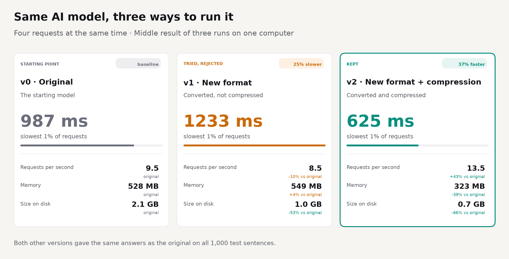
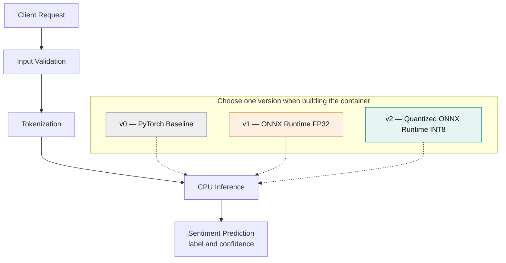
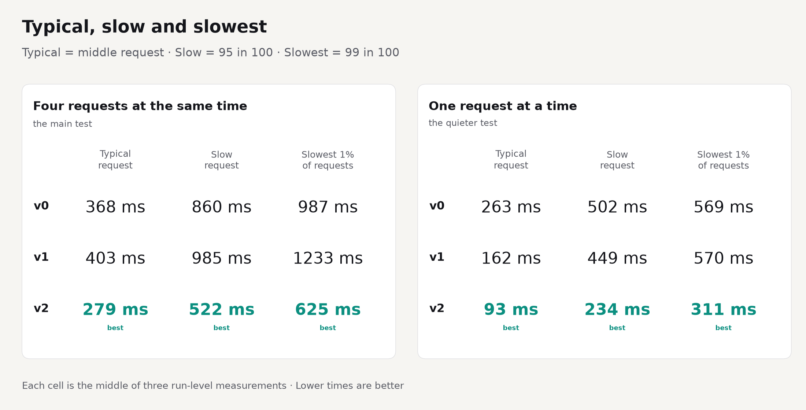

# Measured Model Serving

**An evidence-driven evaluation of CPU inference performance using PyTorch, ONNX Runtime, and dynamic quantization.**

I evaluated three implementations of a sentiment-classification service under controlled CPU and memory limits, with no GPU inference.
I measured inference latency, throughput, memory consumption, and container image size.

Under the primary workload, the optimized implementation achieved 37% lower p99 latency and 39% lower measured peak container memory than the baseline.
ONNX Runtime FP32 (v1), as implemented, increased p99 latency and was rejected.





[Full benchmark report](docs/benchmark_report.md) · [Engineering log](docs/engineering-log.md) · [Reproduce it](#how-to-reproduce-it) · [Saved evidence](docs/benchmark_report.md#original-evidence)

## What I measured and why

The service performs sentiment classification: it predicts a positive or negative label for English text.
I compared three implementations of the same model:

- **v0 — PyTorch / Transformers:** the baseline implementation.
- **v1 — ONNX Runtime FP32:** a converted model using ONNX Runtime, an execution engine for models in the ONNX format, with 32-bit floating-point weights.
- **v2 — ONNX Runtime with signed INT8 dynamic quantization:** selected matrix weights use signed 8-bit integers; activation quantization parameters are calculated during inference. The embedding tables remain in their original floating-point format.

Quantization reduces numerical precision and can reduce memory consumption or inference latency, but may also change predictions.

I used a fixed set of 1,000 synthetic sentences, four CPU cores, a 2 GiB container memory limit, and three valid runs per workload setting.
The sentences were not human-labelled accuracy data.
Performance was evaluated with individual requests and four concurrent requests.
The concurrent workload determined the optimization decision under the predefined acceptance criteria.
Each run included 100 separate warm-up requests, excluded from reported request timings, throughput, and label comparison.

The [engineering log](docs/engineering-log.md#registered-experiment-design) preserves the exact metric definitions, acceptance criteria, and validity checks.
I use decimal units for the rounded results: 1 MB = 1,000,000 bytes and 1 GB = 1,000,000,000 bytes.

## Results

<!-- portfolio:results -->
Under four concurrent requests, v2 reduced median run-level p99 latency from 987 to 625 milliseconds: a 37% reduction.
Peak container memory use fell by 39%. These results apply to this computer and workload.

| Version | Implementation | p99 latency | Throughput (requests/s) | Peak container memory | Container image size | Prediction-label agreement | Decision |
| --- | --- | --- | --- | --- | --- | --- | --- |
| v0 | PyTorch / Transformers | 987 ms | 9.5 | 528 MB | 2.1 GB | Original reference | Baseline |
| v1 | ONNX Runtime FP32 | 1233 ms | 8.5 | 549 MB | 1.0 GB | Yes, all 1,000 sentences | Rejected — approximately 25% higher p99 latency |
| v2 | ONNX Runtime, dynamic INT8 | 625 ms | 13.5 | 323 MB | 0.7 GB | Yes, all 1,000 sentences | Kept — approximately 37% lower p99 latency |

<details>
<summary>Exact numbers and units</summary>

| Version | p50 ms | p95 ms | p99 ms | Requests/s | Peak memory bytes | Peak memory MiB | Image bytes | Startup seconds | Matching HTTP labels | Decision |
| --- | --- | --- | --- | --- | --- | --- | --- | --- | --- | --- |
| v0 | 367.973152 | 859.620583 | 987.331188 | 9.467402148249223 | 527626240 | 503.18359375 | 2106058478 | 10.981760057 | 6000/6000 | BASELINE |
| v1 | 402.820539 | 985.267498 | 1233.355484 | 8.510557636762677 | 549056512 | 523.62109375 | 983250492 | 3.991549434 | 6000/6000 | REJECT |
| v2 | 278.551001 | 522.090772 | 625.352030 | 13.519012621450953 | 323043328 | 308.078125 | 720020107 | 3.246321130 | 6000/6000 | KEEP |

Each value is the median of three valid run-level values at four simultaneous requests. Memory includes startup and warm-ups. MiB means bytes / 1,048,576. Size is Docker's built-image size. The full report retains all ranges and timing definitions.

</details>

p99 latency is the response-time threshold within which 99% of measured requests complete. Lower values indicate better performance near the slow end of the distribution.
The published p99 is the median of three run-level p99 values, calculated separately using the nearest-rank method; requests were not pooled across runs.
Throughput measures completed requests per second. Peak container memory includes startup and warm-ups; container image size measures storage, not running memory.
Both optimized implementations matched baseline prediction labels for all 1,000 fixed test sentences across all six runs each. Prediction-label agreement does not measure accuracy against human labels.
<!-- /portfolio:results -->



<!-- portfolio:findings -->
With individual requests, v1 reduced median run-level p50 latency from 263 to 162 milliseconds.
Its p99 latency was almost unchanged: 569 versus 570 milliseconds.

With four concurrent requests, v1 had higher p50, p95, and p99 latency than v0.
The conversion helped typical single-request latency, but regressed under the primary workload.
I rejected v1 under the predefined acceptance criteria; the single-request improvement did not override the concurrent-workload result.
<!-- /portfolio:findings -->

The [full benchmark report](docs/benchmark_report.md) includes every range, variation warning, and original result file.
The [generated chart data](docs/chart_data.json) records each displayed value, its source, calculation, label, and rendering settings.

## What did not help

<!-- portfolio:rejection -->
I rejected ONNX Runtime FP32 because it increased p99 latency by approximately 25% under the primary concurrent workload.
A smaller container image did not necessarily mean lower inference latency.
The corrected dynamic INT8 implementation met the performance and prediction-label agreement criteria and was selected for this experiment.
<!-- /portfolio:rejection -->

The initial quantization call produced 38 signed INT8 matrix weights and two unsigned UINT8 embedding weights.
It failed the mandatory signed-weight validation before inference, so prediction quality was not evaluated.
The [failed attempt](results/parity/v2-quantization-default-failure.json) and [corrected approach](docs/engineering-log.md#v2-signed-8-bit-integration) remain documented.
The corrected approach quantized only matrix-multiplication weights and preserved the two floating-point embedding tables.
Prediction-label agreement does not imply identical internal numerical values. In the saved runs, v2 confidence scores differed from v0 by up to about 0.18 while prediction labels remained unchanged.

## What I learned

- A faster model stage did not make the whole service faster: in v1, tokenization added about 89 ms per request at concurrency 4.
- Single-request and concurrent workloads exposed different performance trade-offs.
- I used predefined acceptance criteria to avoid selecting only favorable results.
- I checked prediction-label agreement after quantization; lower precision can change predictions.
- Latency, throughput, memory consumption, and container image size are distinct optimization targets.
- I preserved rejected experiments to make the final decision inspectable.
- Reproducibility requires preserved inputs, model artifacts, environment information, and executable procedures.

## How to reproduce it

**From committed evidence:** anyone can read the [full report](docs/benchmark_report.md) and [chart data](docs/chart_data.json) without model files.
Before sourcing `scripts/env.sh`, create a project-local virtual environment with `python3.14 -m venv .venv`.
The environment script activates that existing environment and sets main-disk temporary/cache paths; it does not install dependencies.
Install the [pinned offline dependencies selected by CI](.github/workflows/ci.yml), then check the report without writing:

```bash
source scripts/env.sh
python bench/report.py --check
```

To regenerate the report and both images, install CPU-only PyTorch first from `https://download.pytorch.org/whl/cpu`, then the existing pinned development dependencies, and run `make report`.
The renderer uses the locally available DejaVu Sans font; no font download is needed.
See the [reporting setup and commands](docs/engineering-log.md#portfolio-reporting).

**From prepared files and verified container images:** the documented `make bench BENCH_OUTPUT=tmp/reproductions/new-run` repeats the controlled protocol.
It requires the original verified images and model files on supported ARM64 Linux.
It writes a new destination and never replaces original results.
See [controlled rerun instructions](docs/engineering-log.md#rerunning-the-performance-experiment).

**From a fresh clone:** artifact preparation is incomplete.
The full test suite needs the prepared model files first.
`make setup` prepares the original v0 model files; it does not prepare the converted v1/v2 files.
Those still require the [documented artifact preparation and its current restrictions](docs/engineering-log.md#rebuilding-artifacts-and-services).
Normal service requests only load local files.

`make test` runs the model-free checks; `make test-local` additionally needs the prepared model files.
These are different from running a performance experiment.

## Limitations

- One computer, one small English sentiment model, and fixed synthetic inputs do not represent a production load-test of real user traffic.
- I compared answers with the original model, not with human labels. This is not a measurement of real-world accuracy.
- Each setting had only three runs. The original and changed versions were measured on different dates on a shared virtual machine.
- Client and server shared that machine. Other host activity and virtual-machine scheduling could affect results.
- Each container had four CPU cores, a 2 GiB memory limit, and one server worker. Other limits may change the outcome.
- Another CPU, including an x86 machine, or a different workload may produce different results.
- Some timing, memory, and startup measurements varied substantially. All [variation warnings and ranges](docs/benchmark_report.md#variation-disclosures) remain available.
- Recreating every model file from a fresh clone is not fully automatic. Historical preparation guards remain in place.
- The historical model-licence record lacks the cached material needed for independent offline re-verification.

## Licences and provenance

My project code uses the [MIT licence](LICENSE). Model weights and dependencies retain their own licences.
The full [third-party licence table](docs/engineering-log.md#dependencies-licences-and-provenance) distinguishes local package evidence from upstream statements.

The model is `distilbert/distilbert-base-uncased-finetuned-sst-2-english`, revision `714eb0fa89d2f80546fda750413ed43d93601a13`.
Historical records report **Apache-2.0** for its [pinned-revision model card](https://huggingface.co/distilbert/distilbert-base-uncased-finetuned-sst-2-english/blob/714eb0fa89d2f80546fda750413ed43d93601a13/README.md).
This update checked that the link resolves. It did not independently establish the historical build-time licence check.
The original offline verification caveat remains in the engineering log.

The base image is `python:3.14.4-slim-bookworm`, pinned to index digest
`sha256:fc74d22ffd0d5ac395a4b7bdda75a4539758862c49ebf3005647084631e63789`.
The [baseline provenance record](docs/engineering-log.md#pinned-local-v0-baseline) also preserves its exact ARM64 manifest digest and original file hashes.

## Technical details

[Architecture and service contract](docs/engineering-log.md#architecture-and-engineering-choices) · [Service API](docs/engineering-log.md#service-api) · [Registered rules and formulas](docs/engineering-log.md#registered-experiment-design) · [Thread selection](docs/engineering-log.md#thread-selection) · [Full results](docs/benchmark_report.md) · [Historical experiments](docs/engineering-log.md#historical-evidence)

The exact versions are v0 PyTorch/Transformers, v1 ONNX Runtime, and v2 ONNX Runtime with signed INT8 MatMul-only dynamic quantization.
A single version is chosen when the container is built; the request does not run all three.
Each image uses one worker and four model threads, without dynamic batching or GPU inference.
The memory limit is exactly 2,147,483,648 bytes (2 GiB). Precise memory measurements use `cgroup memory.peak`.

<details>
<summary>Glossary</summary>

- **p50:** the halfway point after sorting one run's request times.
- **p95:** the time at or below which 95% of that run's requests finished.
- **p99:** the time at or below which 99% finished; the registered nearest-rank position is 990 of 1,000.
- **Concurrent requests:** requests in progress at the same time.
- **Dynamic quantization:** storing selected weights as lower-precision integers and calculating activation quantization parameters during inference. It can change predictions.
- **ONNX / ONNX Runtime:** an exchange format for model graphs and the execution engine used for v1 and v2.
- **Prediction-label agreement:** whether an implementation predicts the same label as v0 for each sentence ID; this is not human-labelled accuracy.
- **Container memory:** memory recorded for the isolated service, including startup and warm-ups; this is not just model-file size.

</details>

<details>
<summary>Original result file checksums</summary>

```text
b07d24a12eb3d97a9dff2d32ac6e344ca79f02c6093157f20a8ffd9383b4cd58  results/v1-official/attempt-57f9c386c6724d6fafa7f92dcac29082.json
e3d0e8b739d1c9cea102b277a40ef44bc3e550368d151f42f83d8e4ff49c7f66  results/v1-official/attempt-5e9e84aaf4664cd581795c09d4731206.json
642162a734016979e9c92729cee7e440f3dc17012af4315999d84a2c30cfff94  results/v1-official/attempt-b02462327cab4e869a10d664fb598177.json
ab01c665f9fbd5f98865d27c07c8c933a950a4ad784e626db3bc0cfba7ca217a  results/v1-official/attempt-c04413f245f047f5a3a8808ae4abea5f.json
b77cd04ee2244cb20a734e9c0907f9ce927817a30f6a7f637603f4679a2b5d97  results/v1-official/attempt-e87b51c5d5304dd0a6cfd12e33f76671.json
f8053d7d6b4ba515e5e94ef49f5344ec7e6be5cdc48d2198c1e4ed572b6e2a00  results/v1-official/attempt-ec55d0b8a88c4da9b49b779b40bf6da3.json
ec85187349ed7b8fe5952fa03e08dd8a2568fdadfcc7fddc297aacb1abd8c22e  results/v1-official/summary-2c94ca783707487b85afc345c16dbbe9.json
77aacc2a4987f2d9cd5ab25623401ca67b3d2dc01b2ce354990e6a6c75b28662  results/v1-official/summary-ba51d0c2eac04d39a0e6cd238e45110d.json
a8193282c07c616587b81697a733aa2b53f427a2a73d4234a0bf217d583c52ae  results/v2-official/attempt-1c27a767a2c94168be97a447e949d3cd.json
9acae347a37b2f0cf262f909e0e83831e19d4db175c5dc6289bba80d6a0d43c9  results/v2-official/attempt-96b154b38fe1423d9eb2d1c0d76c7bfe.json
4166838bccfb4f0fdf7242883888a693b09205216ca26285461f8bb8658116d9  results/v2-official/attempt-a76714bbf76f4965aaea9c03241c8737.json
d564d6a32de43e7c869bdb6814747a15983e94ec128f707add513bf2a7879797  results/v2-official/attempt-a84612ed4fda43c29a4ebde58c2a5551.json
ead7e0b2b79ad29d1f43746d69c5d1718b0f7178c66dd7cbf669bbdf91c00e23  results/v2-official/attempt-c05c694963984cd4b0793e16ae84d0e4.json
1c73197d569af03c8979d32b638eb8c7c9e90cb5c4a0fac5475e6c2d2c7b4d58  results/v2-official/attempt-ff98a85ca1a941dd822df0e5ef83f1a6.json
6fb79e8e029b708490242e7fad5046faeb85de334d4748f0c84dd4c748302688  results/v2-official/summary-18cd5dd068124ae38962211a4bce2b0f.json
70a7f930d6c2c6d0ad885dc0ad4e9b3090a6e92d052e241b9c7d9f94fb5e9836  results/v2-official/summary-2c7cdd05a3584f1ea926c28f7f6faaba.json
```

</details>
