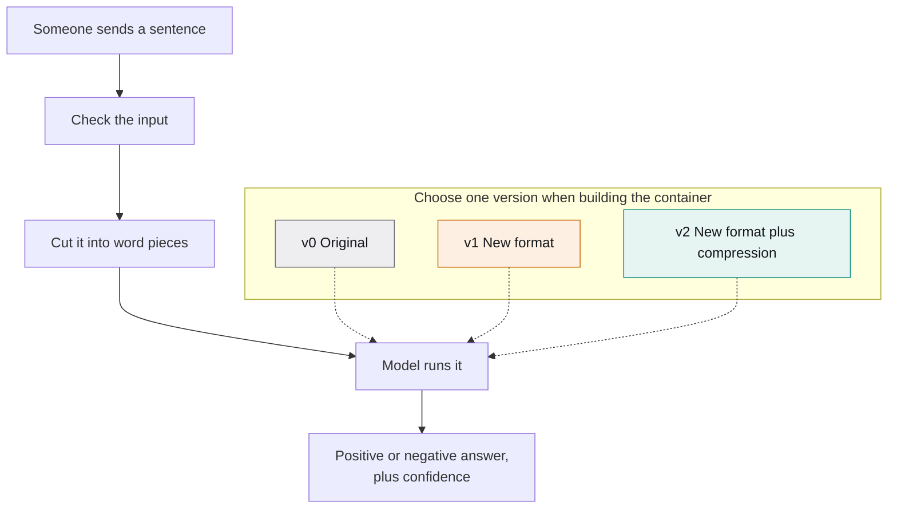

# Measured Model Serving

I made a sentence-reading model respond faster on an ordinary computer chip without a graphics card, then measured each change—including one that made it worse.




[Full benchmark report](docs/benchmark_report.md) · [Engineering log](docs/engineering-log.md) · [Reproduce it](#how-to-reproduce-it) · [Saved evidence](docs/benchmark_report.md#original-evidence)

## What I measured and why

The service reads an English sentence and predicts whether its tone is positive or negative.
I compared three ways of running the same model, including a smaller representation of its numbers.

I measured response time, requests handled per second, memory use, and size on disk.
The main test sent four requests at the same time, with fixed processor and memory limits.
I also measured requests arriving one by one.

Each setting used three valid runs of the same 1,000 made-up sentences.
Separate warm-up requests were excluded.
I kept the rules and original records so another person can check the decisions.

I use decimal units here: 1 MB = 1,000,000 bytes and 1 GB = 1,000,000,000 bytes.

## Results

<!-- portfolio:results -->
I reduced the delay reached by 99 in 100 requests from about 987 to 625 milliseconds: a 37% reduction.
Its measured memory use fell by 39%. These results apply to this computer and workload.

| Version | What it is | Slowest 1% of requests | Requests per second | Memory | Size on disk | Same answers as original | Decision |
| --- | --- | --- | --- | --- | --- | --- | --- |
| v0 | The starting model | 987 ms | 9.5 | 528 MB | 2.1 GB | Original reference | Starting point |
| v1 | Converted, not compressed | 1233 ms | 8.5 | 549 MB | 1.0 GB | Yes, all 1,000 sentences | Rejected: 25% slower |
| v2 | Converted and compressed | 625 ms | 13.5 | 323 MB | 0.7 GB | Yes, all 1,000 sentences | Kept: 37% faster |

<details>
<summary>Exact numbers and units</summary>

| Version | p50 ms | p95 ms | p99 ms | Requests/s | Peak memory bytes | Peak memory MiB | Image bytes | Startup seconds | Matching HTTP labels | Decision |
| --- | --- | --- | --- | --- | --- | --- | --- | --- | --- | --- |
| v0 | 367.973152 | 859.620583 | 987.331188 | 9.467402148249223 | 527626240 | 503.18359375 | 2106058478 | 10.981760057 | 6000/6000 | BASELINE |
| v1 | 402.820539 | 985.267498 | 1233.355484 | 8.510557636762677 | 549056512 | 523.62109375 | 983250492 | 3.991549434 | 6000/6000 | REJECT |
| v2 | 278.551001 | 522.090772 | 625.352030 | 13.519012621450953 | 323043328 | 308.078125 | 720020107 | 3.246321130 | 6000/6000 | KEEP |

Each value is the median of three valid run-level values at four simultaneous requests. Memory includes startup and warm-ups. MiB means bytes / 1,048,576. Size is Docker's built-image size. The full report retains all ranges and timing definitions.

</details>

The slowest-1% column is the 99-in-100 timing threshold. Percent faster means a reduction in that delay.
Both other versions matched the original answers for all 1,000 fixed test sentences across all six runs each. Matching answers does not measure accuracy against human labels.
<!-- /portfolio:results -->


<!-- portfolio:findings -->
With one request at a time, v1 improved the typical wait from 263 to 162 milliseconds.
Its slowest-1% time was almost unchanged: 569 versus 570 milliseconds.

With four requests at the same time, v1 was slower at every reported delay point.
The format change helped when requests came one by one, but not when several arrived together.
I decided in advance that the busy case decides, so I rejected the format-only version.
<!-- /portfolio:findings -->

The [full benchmark report](docs/benchmark_report.md) includes every range, variation warning, and original result file.
The [generated chart data](docs/chart_data.json) records each displayed value, its source, calculation, label, and rendering settings.

## What did not help

<!-- portfolio:rejection -->
Converting the model to another format made the slowest requests about 25% slower in the busy test, so I rejected that version.
Compressing the converted model produced the observed improvement.
A smaller download did not guarantee a shorter wait.
<!-- /portfolio:rejection -->

The first compression attempt also failed a check on how the model's numbers were stored.
I stopped it before evaluating its answers.
The [failed attempt](results/parity/v2-quantization-default-failure.json) and [corrected approach](docs/engineering-log.md#v2-signed-8-bit-integration) remain documented.
Matching answers after compression does not mean that every internal number stayed identical.

## What I learned

- A format change alone did not guarantee better performance.
- Testing several requests together changed the apparent winner.
- I set pass/fail rules before measuring the changed versions.
- I checked whether compression changed the model's answers.
- I measured memory and image size alongside response time.
- I kept failed experiments so others could understand the decisions.
- I learned that reproduction needs prepared files and verified images, beyond a successful test command.

## How to reproduce it

**From committed evidence:** anyone can read the [full report](docs/benchmark_report.md) and [chart data](docs/chart_data.json) without model files.
With the pinned offline test dependencies installed, check the report without writing:

```bash
source scripts/env.sh
python bench/report.py --check
```

To regenerate the report and both images, install the existing pinned development dependencies and run `make report`.
The renderer uses the locally available DejaVu Sans font; no font download is needed.
See the [reporting setup and commands](docs/engineering-log.md#portfolio-reporting).

**From prepared files and verified container images:** the documented `make bench BENCH_OUTPUT=tmp/reproductions/new-run` repeats the controlled protocol.
It requires the original verified images and model files on supported ARM64 Linux.
It writes a new destination and never replaces original results.
See [controlled rerun instructions](docs/engineering-log.md#rerunning-the-performance-experiment).

**From a fresh clone:** artifact preparation is incomplete.
The full test suite needs the prepared model files first.
`make setup` prepares the original v0 model files; it does not prepare the converted v1/v2 files.
Those still require the [documented artifact preparation and its current restrictions](docs/engineering-log.md#rebuilding-artifacts-and-services).
Normal service requests only load local files.

`make test` runs the model-free checks; `make test-local` additionally needs the prepared model files.
These are different from running a performance experiment.

## Limitations

- One computer, one small English model, and a fixed set of made-up sentences do not represent real user traffic.
- I compared answers with the original model, not with human labels. This is not a measurement of real-world accuracy.
- Each setting had only three runs. The original and changed versions were measured on different dates on a shared virtual machine.
- Client and server shared that machine. Other host activity and virtual-machine scheduling could affect results.
- Each container had four processor cores, a fixed memory limit, and one server worker. Other limits may change the outcome.
- Another processor, including an x86 machine, or a different workload may produce different results.
- Some timing, memory, and startup measurements varied substantially. All [variation warnings and ranges](docs/benchmark_report.md#variation-disclosures) remain available.
- Recreating every model file from a fresh clone is not fully automatic. Historical preparation guards remain in place.
- The historical model-licence record lacks the cached material needed for independent offline re-verification.

## Licences and provenance

My project code uses the [MIT licence](LICENSE). Model weights and dependencies retain their own licences.
The full [third-party licence table](docs/engineering-log.md#dependencies-licences-and-provenance) distinguishes local package evidence from upstream statements.

The model is `distilbert/distilbert-base-uncased-finetuned-sst-2-english`, revision `714eb0fa89d2f80546fda750413ed43d93601a13`.
Historical records report **Apache-2.0** for its [pinned-revision model card](https://huggingface.co/distilbert/distilbert-base-uncased-finetuned-sst-2-english/blob/714eb0fa89d2f80546fda750413ed43d93601a13/README.md).
This update checked that the link resolves. It did not independently establish the historical build-time licence check.
The original offline verification caveat remains in the engineering log.

The base image is `python:3.14.4-slim-bookworm`, pinned to index digest
`sha256:fc74d22ffd0d5ac395a4b7bdda75a4539758862c49ebf3005647084631e63789`.
The [baseline provenance record](docs/engineering-log.md#pinned-local-v0-baseline) also preserves its exact ARM64 manifest digest and original file hashes.

## Technical details

[Architecture and service contract](docs/engineering-log.md#architecture-and-engineering-choices) · [Service API](docs/engineering-log.md#service-api) · [Registered rules and formulas](docs/engineering-log.md#registered-experiment-design) · [Thread selection](docs/engineering-log.md#thread-selection) · [Full results](docs/benchmark_report.md) · [Historical experiments](docs/engineering-log.md#historical-evidence)

The exact versions are v0 PyTorch/Transformers, v1 ONNX Runtime, and v2 ONNX Runtime with signed INT8 MatMul-only dynamic quantization.
A single version is chosen when the container is built; the request does not run all three.
Each image uses one worker and four model threads, without dynamic batching or graphics-card inference.
The memory limit is exactly 2,147,483,648 bytes (2 GiB). Precise memory measurements use `cgroup memory.peak`.

<details>
<summary>Glossary</summary>

- **p50:** the halfway point after sorting one run's request times.
- **p95:** the time at or below which 95% of that run's requests finished.
- **p99:** the time at or below which 99% finished; the registered nearest-rank position is 990 of 1,000.
- **Requests at the same time (concurrency):** how many requests can be in progress together.
- **Compression (quantization):** storing some model numbers with less detail. It can reduce size or time, but may change answers.
- **ONNX:** a model format used here with another program that runs the model.
- **Label agreement:** whether a version gives the same positive/negative answer as v0 for the same sentence ID.
- **Container memory:** memory recorded for the isolated service, including startup and warm-ups; this is not just model-file size.

</details>

<details>
<summary>Original result file checksums</summary>

```text
b07d24a12eb3d97a9dff2d32ac6e344ca79f02c6093157f20a8ffd9383b4cd58  results/v1-official/attempt-57f9c386c6724d6fafa7f92dcac29082.json
e3d0e8b739d1c9cea102b277a40ef44bc3e550368d151f42f83d8e4ff49c7f66  results/v1-official/attempt-5e9e84aaf4664cd581795c09d4731206.json
642162a734016979e9c92729cee7e440f3dc17012af4315999d84a2c30cfff94  results/v1-official/attempt-b02462327cab4e869a10d664fb598177.json
ab01c665f9fbd5f98865d27c07c8c933a950a4ad784e626db3bc0cfba7ca217a  results/v1-official/attempt-c04413f245f047f5a3a8808ae4abea5f.json
b77cd04ee2244cb20a734e9c0907f9ce927817a30f6a7f637603f4679a2b5d97  results/v1-official/attempt-e87b51c5d5304dd0a6cfd12e33f76671.json
f8053d7d6b4ba515e5e94ef49f5344ec7e6be5cdc48d2198c1e4ed572b6e2a00  results/v1-official/attempt-ec55d0b8a88c4da9b49b779b40bf6da3.json
ec85187349ed7b8fe5952fa03e08dd8a2568fdadfcc7fddc297aacb1abd8c22e  results/v1-official/summary-2c94ca783707487b85afc345c16dbbe9.json
77aacc2a4987f2d9cd5ab25623401ca67b3d2dc01b2ce354990e6a6c75b28662  results/v1-official/summary-ba51d0c2eac04d39a0e6cd238e45110d.json
a8193282c07c616587b81697a733aa2b53f427a2a73d4234a0bf217d583c52ae  results/v2-official/attempt-1c27a767a2c94168be97a447e949d3cd.json
9acae347a37b2f0cf262f909e0e83831e19d4db175c5dc6289bba80d6a0d43c9  results/v2-official/attempt-96b154b38fe1423d9eb2d1c0d76c7bfe.json
4166838bccfb4f0fdf7242883888a693b09205216ca26285461f8bb8658116d9  results/v2-official/attempt-a76714bbf76f4965aaea9c03241c8737.json
d564d6a32de43e7c869bdb6814747a15983e94ec128f707add513bf2a7879797  results/v2-official/attempt-a84612ed4fda43c29a4ebde58c2a5551.json
ead7e0b2b79ad29d1f43746d69c5d1718b0f7178c66dd7cbf669bbdf91c00e23  results/v2-official/attempt-c05c694963984cd4b0793e16ae84d0e4.json
1c73197d569af03c8979d32b638eb8c7c9e90cb5c4a0fac5475e6c2d2c7b4d58  results/v2-official/attempt-ff98a85ca1a941dd822df0e5ef83f1a6.json
6fb79e8e029b708490242e7fad5046faeb85de334d4748f0c84dd4c748302688  results/v2-official/summary-18cd5dd068124ae38962211a4bce2b0f.json
70a7f930d6c2c6d0ad885dc0ad4e9b3090a6e92d052e241b9c7d9f94fb5e9836  results/v2-official/summary-2c7cdd05a3584f1ea926c28f7f6faaba.json
```

</details>
